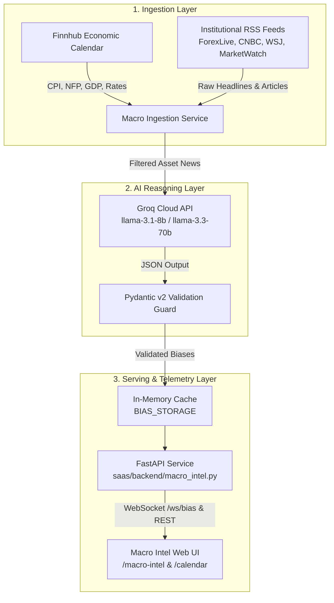

# 🌍 Macroeconomic Intelligence Platform (Macro Intel)

## 📌 Overview
The **Macroeconomic Intelligence Platform (Macro Intel)** is an automated, real-time macroeconomic intelligence and sentiment analysis system. It ingests global economic calendar releases, central bank policy announcements, and institutional financial news, evaluates their systemic market impact using Cloud LLM reasoning (**Groq AI**), and streams validated directional market bias signals to an interactive web terminal.

---

## 🏛️ System Architecture

The platform operates as a focused, decoupled intelligence pipeline:



---

## 🌐 Core Macro Intel Features

All capabilities in this platform are strictly focused on macroeconomic intelligence, market sentiment, and economic calendar analysis:

### 1. 📊 Daily Asset Bias Cards (`/macro-intel`)
Real-time quantitative directional sentiment evaluated across core asset classes (**USD**, **EUR/USD**, **Gold**, **S&P 500**, **Crude Oil**, **Bitcoin**):
* **Directional Stance**: Clear, decisive classification (**Bullish**, **Bearish**, or **Neutral**).
* **Confidence Metric**: Quantified probability score (0% to 100%).
* **3-Word Primary Driver**: Concise institutional-grade summary of the dominant market catalyst (e.g., *"Hawkish Fed Stance"*, *"Safe-Haven Demand Balance"*).
* **AI Summarization**: 1–2 sentence synthesis explaining macroeconomic reasoning and headwind/tailwind interactions.
* **Proof of Data**: Top cited news articles with source attribution, headlines, and direct links.

---

### 2. 📅 Interactive Economic Calendar & Deviation Alerts (`/calendar`)
High-density macroeconomic tracking matrix for global data releases:
* **Core Indicators**: Live monitoring of high-impact releases including **CPI**, **PPI**, **Non-Farm Payrolls (NFP)**, **GDP**, **Retail Sales**, and **Interest Rate Decisions**.
* **Consensus vs. Actual Deviation**: Automated visual color coding (🟢 Green = Beat Consensus, 🔴 Red = Missed Consensus) with pre-release pending countdowns.
* **Smart Deviation Formula**: Quantifies variance between institutional consensus forecasts and actual prints:
  $$\text{Deviation} = \text{Actual} - \text{Consensus}$$

---

### 3. 🏛️ Central Bank Policy & Speech Sentiment Engine (`/macro-intel`)
* **Interest Rate Decision Tracker**: Monitors policy adjustments in Basis Points ($100\text{ bps} = 1.00\%$) across the Federal Reserve, ECB, BoE, and BoJ.
* **Qualitative Speech NLP Parser**: Natural language scoring analyzing press conference transcripts, FOMC statements, and central bank speeches on a continuous scale:
  * **`-1.0`**: Strongly Dovish (Rate cuts, easing, stimulus)
  * **`0.0`**: Neutral / Data-Dependent
  * **`+1.0`**: Strongly Hawkish (Rate hikes, quantitative tightening)
* **Forward Guidance Scanner**: Automated detection of linguistic shifts in central bank releases.

---

### 4. 🌍 Global Macro Sentiment Index
* **Aggregate Sentiment Gauge**: Real-time score from **0 (Extreme Fear)** to **100 (Extreme Greed)** evaluating broader market regime stability.
* **Macro Regime Label**: Classification into *Extreme Fear*, *Bearish*, *Neutral*, *Mild Greed*, or *Extreme Greed*.
* **Macro Summary**: Single-sentence high-level overview of global market liquidity and risk appetite.

---

## ⚙️ Configuration & Environment

Configuration parameters are stored in `system.env`:

```env
GROQ_API_KEY=your_groq_api_key_here
FINNHUB_API_KEY=your_finnhub_api_key_here
PORT=8000
```

---

## 🚀 Running the Macro Intel Platform

### 1. Start the Macro Intel Backend API:
```bash
uvicorn app.main:app --reload --port 8000
```

### 2. Start the Frontend Web Interface:
```bash
cd supernova-ai-trading-system
npm run dev
```

### 3. Open in Browser:
* **Macro Intel Space**: [http://localhost:3000/macro-intel](http://localhost:3000/macro-intel)
* **Economic Calendar**: [http://localhost:3000/calendar](http://localhost:3000/calendar)
* **Backend API Docs**: [http://localhost:8000/docs](http://localhost:8000/docs)

---

## 🗺️ Project Navigation

* [Macroeconomic Architecture & Blueprint](./READMEf1.md)
* [Central Navigation Hub](./Dashboard.md)
