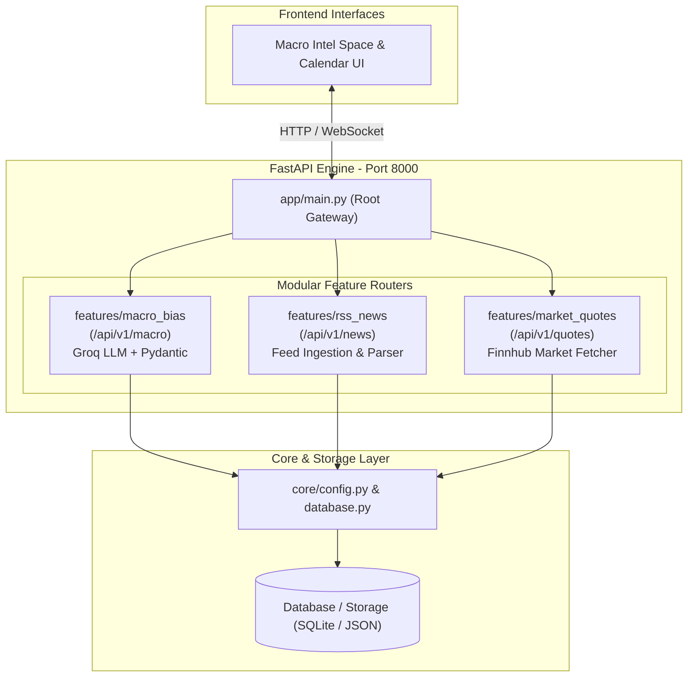

# 📈 Automated Macroeconomic Market Bias Engine
> **Architecture & Implementation Blueprint**
> *An automated, low-latency market-bias evaluation engine using macroeconomic data ingestion and local LLM quantitative reasoning.*

---

## 📌 Executive Overview

The **Automated Macroeconomic Market Bias Engine** is an intelligent processing pipeline designed to ingest macroeconomic calendar data, financial news events, and market indicators, evaluate their systemic impact using a Cloud API LLM (`llama-3.1-8b-instant` via **Groq**), and produce validated, actionable daily market bias signals.

By relying on high-speed cloud AI inference and strict JSON schema validation via **Pydantic**, the engine ensures zero local server load, low-latency processing, and deterministic output structure suitable for direct consumption by the Macro Intelligence Terminal.

---

## 🏗️ System Architecture & Code Structure

> **Code Organization:** The codebase is split into dedicated feature folders to keep files small, clean, and easy to review in pull requests. All feature routers plug into a single FastAPI instance.

### 📂 Directory & Feature Layout

```text
macro-economy/
├── app/
│   ├── main.py                     # Entry point (tiny, rarely changes)
│   │
│   ├── features/
│   │   ├── macro_bias/             # 📂 FEATURE 1: All Macro Bias code lives here
│   │   │   ├── router.py           # FastAPI endpoints (/api/v1/macro/...)
│   │   │   ├── service.py          # Groq LLM & business logic
│   │   │   ├── schemas.py          # Pydantic models
│   │   │   └── tests.py            # Feature-specific tests
│   │   │
│   │   ├── rss_news/               # 📂 FEATURE 2: All RSS News code lives here
│   │   │   ├── router.py           # Endpoints (/api/v1/news/...)
│   │   │   ├── parser.py           # XML / feedparser logic
│   │   │   └── schemas.py          # Pydantic models
│   │   │
│   │   └── market_quotes/          # 📂 FEATURE 3: All Market Price code lives here
│   │       ├── router.py           # Endpoints (/api/v1/quotes/...)
│   │       └── service.py          # Finnhub API calls
│   │
│   └── core/                       # Shared utilities (DB, Config, Logging)
│       ├── config.py
│       └── database.py
```

The system coordinates these features in a clean processing flow:



### 1. Data Ingestion (RSS Ingestion Layer)
To establish baseline macroeconomic conditions, the engine uses a 30-second automated polling loop to pull real-time XML data from institutional news feeds:
* **Primary Providers**: **ForexLive**, **CNBC**, and **WSJ Markets**.
* **Keyword Filtering Engine**: The ingestion engine actively scans headlines and descriptions, strictly filtering for target assets (e.g., **Gold**, **Oil**, **NASDAQ**). Only articles matching these targets are processed.

### 2. AI Analysis (Groq API LLM Inference)
Text analysis and quantitative macroeconomic reasoning are performed via high-speed API:
* **LLM Engine**: [Groq](https://groq.com/) running `llama-3.1-8b-instant`.
* **Prompt Engineering**: The Python backend formats the raw filtered RSS headlines and truncates descriptions (to prevent token limit breaches), instructing the model to act as a Quantitative Macro Strategist and output a concise **3-word summary** of the bias.
* **Execution**: Managed via the `groq` Python library utilizing the `GROQ_API_KEY`.

### 3. Schema Validation & Signal Output
To guarantee downstream system compatibility, raw LLM output is validated before persistence:
* **Schema Enforcement**: The Groq client is configured to output responses strictly structured as JSON (`response_format={"type": "json_object"}`).
* **Pydantic Guard**: Strict schema validation ensures missing fields, out-of-range confidence scores, or invalid bias enums are rejected or re-prompted automatically.

---

## ⚙️ Technical Stack Recommendations

| Component | Technology | Description / Usage |
| :--- | :--- | :--- |
| **Language** | `Python 3.10+` | Core engine backend and orchestration scripts |
| **Data Ingestion** | `httpx` / `requests` | Asynchronous/synchronous HTTP client for Finnhub API |
| **AI Inference** | `Groq API` (`llama-3.1-8b-instant`) | Cloud LLM execution runtime |
| **Data Validation** | `Pydantic v2` | Data contract enforcement & schema validation |
| **Persistence** | `SQLite3` / `JSON File Store` | Signal storage for historical tracking & dashboard API |
| **Task Automation** | `Cron` / `Systemd` / `pm2` | Scheduled daily processing & background daemon execution |

---

## 📊 Target Output Schema & Data Contracts

### JSON Schema Definition

The AI output must adhere strictly to the following draft-07 JSON schema specification:

```json
{
  "$schema": "http://json-schema.org/draft-07/schema#",
  "title": "DailyMarketBias",
  "type": "object",
  "properties": {
    "date": {
      "type": "string",
      "format": "date",
      "description": "ISO 8601 date format (YYYY-MM-DD)"
    },
    "asset_class": {
      "type": "string",
      "description": "Specific market or asset analyzed (e.g., USD, S&P 500, Gold, EUR/USD)"
    },
    "bias": {
      "type": "string",
      "enum": ["Bullish", "Bearish", "Neutral"],
      "description": "Determined directional market sentiment"
    },
    "confidence_score": {
      "type": "integer",
      "minimum": 0,
      "maximum": 100,
      "description": "Probability or confidence of the assigned bias"
    },
    "key_drivers": {
      "type": "array",
      "items": { "type": "string" },
      "description": "Exactly a 3-word summary of the primary macro driver"
    },
    "latest_news": {
      "type": "array",
      "items": {
        "type": "object",
        "properties": {
          "title": { "type": "string" },
          "source": { "type": "string" },
          "link": { "type": "string" }
        }
      },
      "description": "Top 3 raw RSS news articles injected by the backend for frontend rendering (Proof of Data)."
    }
  },
  "required": ["date", "asset_class", "bias", "confidence_score", "key_drivers"]
}
```

### Python Pydantic Model

```python
from enum import Enum
from datetime import date
from typing import List
from pydantic import BaseModel, Field

class MarketBiasEnum(str, Enum):
    BULLISH = "Bullish"
    BEARISH = "Bearish"
    NEUTRAL = "Neutral"

class DailyMarketBias(BaseModel):
    date: date
    asset_class: str = Field(..., description="Target asset or currency pair")
    bias: MarketBiasEnum = Field(..., description="Directional bias")
    confidence_score: int = Field(..., ge=0, le=100, description="Confidence score between 0 and 100")
    key_drivers: List[str] = Field(..., min_length=1, description="Macro drivers supporting the bias")
```

---

## 🚀 Implementation Walkthrough

### 1. Finnhub Data Ingestion
```python
import httpx

def fetch_economic_calendar(api_key: str, start_date: str, end_date: str):
    url = f"https://finnhub.io/api/v1/economic?from={start_date}&to={end_date}&token={api_key}"
    response = httpx.get(url)
    response.raise_for_status()
    return response.json()
```

### 2. Groq API LLM Inference & Validation
```python
import json
import os
from groq import AsyncGroq
from pydantic import ValidationError

async def generate_daily_bias(macro_events: list, asset_class: str = "USD") -> DailyMarketBias:
    prompt = f"""
    You are an expert quantitative macroeconomic strategist.
    Analyze the following macroeconomic events and determine the daily bias for {asset_class}:
    
    Events Data:
    {json.dumps(macro_events, indent=2)}

    Output your analysis strictly in JSON adhering to this structure:
    {{
      "date": "YYYY-MM-DD",
      "asset_class": "{asset_class}",
      "bias": "Bullish" | "Bearish" | "Neutral",
      "confidence_score": 85,
      "key_drivers": ["Driver 1", "Driver 2"]
    }}
    """
    
    groq_client = AsyncGroq(api_key=os.environ.get("GROQ_API_KEY"))
    completion = await groq_client.chat.completions.create(
        messages=[{"role": "user", "content": prompt}],
        model="llama-3.1-8b-instant",
        response_format={"type": "json_object"},
        temperature=0.0
    )
    
    # Parse & Validate output
    raw_json = json.loads(completion.choices[0].message.content)
    validated_bias = DailyMarketBias.model_validate(raw_json)
    return validated_bias
```

---

## 🛣️ Development Roadmap & Next Steps

1. **🌐 Establish Data Feed Integration**
   - Implement `Finnhub` API integration with error handling, rate limiting, and caching.
2. **🤖 Prompt Engineering & Tuning**
   - Refine system prompt instructions for consistent economic event weighting and zero-shot accuracy.
3. **☁️ Groq Cloud API Deployment**
   - Secure `GROQ_API_KEY` and benchmark `llama-3.1-8b-instant` for speed, JSON format compliance, and analytical precision.
4. **🛡️ Validation Guardrails & Retry Logic**
   - Implement automatic re-prompting if Pydantic schema validation fails.
5. **🗄️ Database & API Storage**
   - Connect validated JSON output to SQLite / PostgreSQL database for historical signal tracking.
6. **📊 Dashboard Integration**
   - Expose endpoints via FastAPI to render real-time market bias cards in the Macro Intel UI.
7. **🔄 Daemon Process Automation**
   - Deploy background cron job or service worker to run daily bias calculations prior to market open.