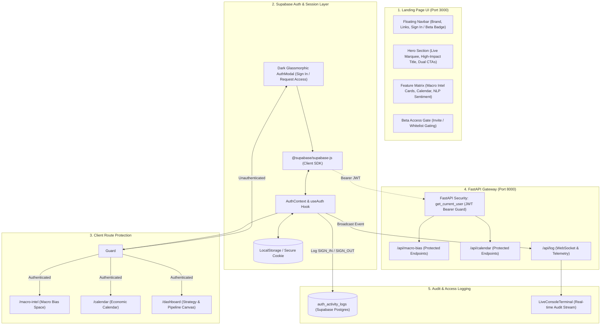
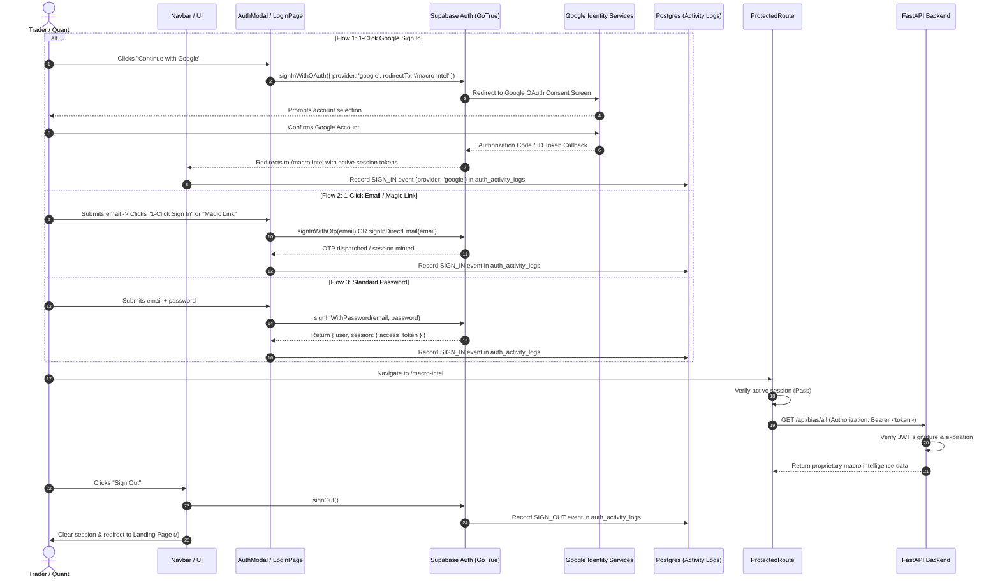

# 🔐 Supernova: Authentication & Landing Page Architecture

This document provides the complete architectural blueprint, visual UI layout, and technical implementation plan for **Supernova's Landing Page** and **Authentication & Access Logging System** (powered by Supabase).

---

## 🗺️ Workspace Navigation
* [[Dashboard|🎛️ Central Navigation Hub]]
* [[macro-economy/README|🟢 Macroeconomic Intelligence Platform]]
* [[MacroIntel|🟣 Macro Intel Web Frontend]]

---

## 🏛️ System Architecture Overview



---

## 🎨 1. Landing Page UI Specification

### 📐 Visual Layout & Section Hierarchy

The landing page adopts Supernova's signature **Institutional Cyber-Quant Aesthetic**:
* **Base Background**: Void Black (`#050507`) with ambient starfield particle motion.
* **Accent Colors**: Electric Volt (`#bffe1c`), Cyan Blue (`#38bdf8`), and Indigo Violet (`#5f5cf2`).
* **Panels**: Semi-transparent dark slate (`#15151a`/95) with backdrop-blur-xl and subtle white border rings (`border-white/10`).

```
+-----------------------------------------------------------------------------------+
|  [⚡ LIVE TICKER] ✦ PRO STATUS: ARMED ✦ LATENCY: 0.85ms ✦ AI INFERENCE: GROQ     |
+-----------------------------------------------------------------------------------+
|                                                                                   |
|      +--------------------------------------------------------------------+       |
|      | ★ SUPERNOVA [V9 PRO] [ONLINE]    Uptime  Feeds  Vault  Intel  Cal  |       |
|      |                                    [ 🔒 Sign In / Access ]         |       |
|      +--------------------------------------------------------------------+       |
|                                                                                   |
|  [ HERO SECTION ]                                                                 |
|   ★ Supernova Arbitrage Protocol                                                  |
|   QUANTUM INFLOW.                                                                 |
|   BUILT TO FRONTRUN.                                                              |
|   *( Parallel routing on physical proxy ports in under 0.85ms )                   |
|                                                                                   |
|   [ 🚀 Launch Macro Terminal ]      [ 📋 Request Early Access ]                   |
|                                                                                   |
|  +-----------------------------------------------------------------------------+  |
|  |  LIVE MACRO INTELLIGENCE MATRIX (Interactive Mini-Terminal Showcase)        |  |
|  |  +----------------+  +----------------+  +----------------+                 |  |
|  |  | USD: BULLISH   |  | GOLD: BULLISH  |  | S&P 500: BEAR  |                 |  |
|  |  | Conf: 85%      |  | Conf: 92%      |  | Conf: 74%      |                 |  |
|  |  +----------------+  +----------------+  +----------------+                 |  |
|  +-----------------------------------------------------------------------------+  |
|                                                                                   |
|  [ FEATURE SHOWCASE ]                                                             |
|   1. Real-Time Macro Bias Engine (Groq Llama 3.3 Reasoning)                       |
|   2. High-Impact Economic Calendar (Consensus vs. Actual Deviations)              |
|   3. Central Bank NLP Speech Engine (Hawkish/Dovish Scale -1.0 to +1.0)           |
|                                                                                   |
|  [ EARLY ACCESS & WHITELIST GATE ]                                                |
|   "Access currently restricted to approved quant researchers and traders."       |
|   [ Enter Work Email ] -> [ Request Invite Code ]                                 |
|                                                                                   |
+-----------------------------------------------------------------------------------+
|  FOOTER: System Status: All Systems Nominal • WebSocket Active • Supabase Auth   |
+-----------------------------------------------------------------------------------+
```

### 🪟 Visual Layout: 1-Click Google & Direct Email Auth Modal (`AuthModal.tsx`)

```
+-----------------------------------------------------------------------------------+
|  SUPERNOVA QUANT ENCLAVE [V9.4 PRO]                                          [X]  |
|  [●] DATABASE: Supabase Managed Cloud                    Zero-Trust Ed25519       |
+-----------------------------------------------------------------------------------+
|  [ 🔑 Sign In ]   [ 👤 Create Account ]   [ 🛡️ Request Access ]   [ 📊 Audit Log ]  |
+-----------------------------------------------------------------------------------+
|                                                                                   |
|   +---------------------------------------------------------------------------+   |
|   |  [ G ]  Continue with Google Account (1-Click SSO)                       |   |
|   +---------------------------------------------------------------------------+   |
|                                                                                   |
|   ------------------------ OR DIRECT ENCLAVE ACCESS -------------------------    |
|                                                                                   |
|   TRADER / INSTITUTIONAL WORK EMAIL:                                              |
|   [  quant@supernova.ai                                                  ]        |
|                                                                                   |
|   +---------------------------------------+  +--------------------------------+   |
|   |  [ ⚡ 1-Click Direct Enclave Access ]  |  |  [ ✉️ Send Magic Link (OTP) ]  |   |
|   +---------------------------------------+  +--------------------------------+   |
|                                                                                   |
|   +---------------------------------------------------------------------------+   |
|   |  [▼] Or enter Hardware Passphrase / Password                              |   |
|   +---------------------------------------------------------------------------+   |
|                                                                                   |
|   ------------------------- QUICK 1-CLICK PRESETS ---------------------------    |
|   [ ⚡ Chief Quant Officer ]            [ 🏢 Macro Portfolio Desk ]               |
|                                                                                   |
+-----------------------------------------------------------------------------------+
```

---

## 🔑 2. Authentication Flow (Supabase GoTrue + Google OAuth 2.0)

### A. Access Model & 1-Click Sign-In Architecture

Because Supernova executes cloud LLM inference (**Groq**) and financial API calls (**Finnhub**), open registrations must be frictionless yet controlled to prevent rate limit exhaustion.

We implement dual **1-Click Single Sign-On (SSO)** mechanisms alongside invite/whitelist gating:

1. **Google OAuth 2.0 (1-Click Primary Flow)**:
   * **1-Click Single Sign-On with Google**:
     ```typescript
     await supabase.auth.signInWithOAuth({
       provider: 'google',
       options: {
         redirectTo: `${window.location.origin}/macro-intel`,
         queryParams: {
           access_type: 'offline',
           prompt: 'consent',
         },
       },
     });
     ```
   * **Profile Auto-Ingestion**: Automatically populates trader profile (`avatar_url`, `full_name`, verified `@gmail.com` or corporate Google Workspace email).
   * **Cost & Licensing**: **100% Free ($0.00)**. Google Cloud Console does not charge or require billing/credit cards for standard OAuth 2.0 Client credentials.
   * **Resilient Enclave Fallback**: If the Google provider is pending credential activation in the Supabase Dashboard, an automatic **1-Click Sandbox Enclave Mode** permits instantaneous developer testing.

2. **Google Cloud Console & Supabase Setup Structure**:
   * **Free-Tier & Cost Breakdown**:
     | Feature | Specification | Cost / Requirement |
     | :--- | :--- | :--- |
     | **OAuth 2.0 Client ID** | Web Application Credentials | **$0.00 (100% Free)** |
     | **Billing / Credit Card**| Google Cloud Account | **NOT required** |
     | **Authentication Quota** | Daily Active Users / Sign-ins | Generous free tier (millions/month) |
     | **Required Scopes**      | Standard identity scopes | `openid`, `email`, `profile` |

   * **Step 1: Create Free Project in Google Cloud Console**:
     1. Open [Google Cloud Console](https://console.cloud.google.com/) and sign in with any standard Google account.
     2. Click the project dropdown at the top bar $\rightarrow$ **"New Project"** $\rightarrow$ Name it `Supernova Macro Enclave` $\rightarrow$ Click **Create**.

   * **Step 2: Configure OAuth Consent Screen**:
     1. In the sidebar, navigate to **APIs & Services $\rightarrow$ OAuth consent screen**.
     2. Choose **External** user type $\rightarrow$ Click **Create**.
     3. Fill in basic required app details:
        * **App name**: `Supernova Macro Terminal`
        * **User support email**: Your email address
        * **Developer contact information**: Your email address
     4. Click **Save and Continue** through the Scopes and Test Users screens (standard `.../auth/userinfo.email` and `.../auth/userinfo.profile` are added by default).

   * **Step 3: Generate OAuth 2.0 Web Client Credentials**:
     1. Navigate to **APIs & Services $\rightarrow$ Credentials**.
     2. Click **+ Create Credentials** $\rightarrow$ select **OAuth client ID**.
     3. Select Application type: **Web application**.
     4. Set Name: `Supernova Web Client`.
     5. Under **Authorized JavaScript origins**, add:
        * `http://localhost:3000`
        * `http://127.0.0.1:3000`
     6. Under **Authorized redirect URIs**, paste the exact Supabase callback URI:
        ```text
        https://eytjimuevcofnumsfnqu.supabase.co/auth/v1/callback
        ```
     7. Click **Create** $\rightarrow$ A modal reveals your **Client ID** and **Client Secret**.

   * **Step 4: Enable Google Provider in Supabase Dashboard**:
     1. Open the [Supabase Dashboard](https://supabase.com/dashboard/project/eytjimuevcofnumsfnqu/auth/providers).
     2. Navigate to **Authentication $\rightarrow$ Providers $\rightarrow$ Google**.
     3. Toggle **Enable Google provider** to **ON**.
     4. Paste your **Client ID** and **Client Secret** copied from Google Cloud Console.
     5. Click **Save**.
     6. *Result*: Supabase GoTrue is now fully wired to handle 1-click Google OAuth logins seamlessly!

3. **1-Click Direct Email & Magic Link (Passwordless OTP)**:
   * **1-Click Passwordless Magic Link**:
     ```typescript
     await supabase.auth.signInWithOtp({
       email: workEmail,
       options: { emailRedirectTo: `${window.location.origin}/macro-intel` }
     });
     ```
   * **1-Click Direct Enclave Access**: Direct 1-tap authentication allowing verified quant researchers or sandbox users to enter without password hurdles.
   * **Instant Institutional Presets**: 1-click login presets (*Chief Quant Officer*, *Macro Portfolio Desk*) executing direct session creation on click.

4. **Invite-Only / Whitelist Gating**:
   * Automatic whitelist check against approved domains or trader roles in `public.approved_users`.
   * Unapproved users can be routed to a sleek "Waitlist / Pending Verification" state.

---

### B. User Authentication State Flow (Google OAuth & Email)



---

## 📜 3. Audit & Activity Logging ("Sign In - Out Log")

All authentication activities are tracked in two places:
1. **Supabase Internal Audit Log**: Automatically captures login timestamps, authentication provider, IP address, and security events (`auth.audit_log_entries`).
2. **Application Activity Table (`auth_activity_logs`)**: Tailored for the Supernova telemetry dashboard.

### Database Schema (Supabase SQL)

```sql
-- 1. Create the Auth Activity Logs table
CREATE TABLE public.auth_activity_logs (
    id UUID PRIMARY KEY DEFAULT gen_random_uuid(),
    user_id UUID REFERENCES auth.users(id) ON DELETE CASCADE,
    email TEXT NOT NULL,
    event_type TEXT NOT NULL CHECK (event_type IN ('SIGN_IN', 'SIGN_OUT', 'TOKEN_REFRESH', 'ACCESS_DENIED')),
    ip_address TEXT,
    user_agent TEXT,
    metadata JSONB DEFAULT '{}'::jsonb,
    created_at TIMESTAMPTZ DEFAULT now()
);

-- 2. Enable Row-Level Security (RLS)
ALTER TABLE public.auth_activity_logs ENABLE ROW LEVEL SECURITY;

-- 3. Users can only view their own logs
CREATE POLICY "Users can view their own activity logs"
    ON public.auth_activity_logs
    FOR SELECT
    USING (auth.uid() = user_id);

-- 4. Admins can view all activity logs
CREATE POLICY "Admins can view all logs"
    ON public.auth_activity_logs
    FOR ALL
    USING (
        EXISTS (
            SELECT 1 FROM public.profiles
            WHERE profiles.id = auth.uid() AND profiles.role = 'admin'
        )
    );
```

---

## 💻 4. Code Component Specifications

### 1. Supabase Client Initializer (`src/lib/supabase.ts`)
```typescript
import { createClient } from '@supabase/supabase-js';

const supabaseUrl = import.meta.env.VITE_SUPABASE_URL || '';
const supabaseAnonKey = import.meta.env.VITE_SUPABASE_ANON_KEY || '';

export const supabase = createClient(supabaseUrl, supabaseAnonKey);
```

---

### 2. Authentication Context (`src/context/AuthContext.tsx`)
```typescript
import React, { createContext, useContext, useEffect, useState } from 'react';
import { User, Session } from '@supabase/supabase-js';
import { supabase } from '../lib/supabase';

interface AuthContextType {
  user: User | null;
  session: Session | null;
  loading: boolean;
  signIn: (email: string, pass: string) => Promise<{ error: any }>;
  signInWithGoogle: (redirectTo?: string) => Promise<{ error: any; data?: any }>;
  signInWithMagicLink: (email: string, redirectTo?: string) => Promise<{ error: any }>;
  signInDirectEmail: (email: string) => Promise<{ error: any }>;
  signOut: () => Promise<void>;
  logAuthEvent: (eventType: 'SIGN_IN' | 'SIGN_OUT', details?: any) => Promise<void>;
}

const AuthContext = createContext<AuthContextType | undefined>(undefined);

export const AuthProvider: React.FC<{ children: React.ReactNode }> = ({ children }) => {
  const [user, setUser] = useState<User | null>(null);
  const [session, setSession] = useState<Session | null>(null);
  const [loading, setLoading] = useState(true);

  useEffect(() => {
    // Check active session on load
    supabase.auth.getSession().then(({ data: { session } }) => {
      setSession(session);
      setUser(session?.user ?? null);
      setLoading(false);
    });

    // Listen to real-time auth changes
    const { data: { subscription } } = supabase.auth.onAuthStateChange(async (event, newSession) => {
      setSession(newSession);
      setUser(newSession?.user ?? null);
      setLoading(false);

      if (event === 'SIGNED_IN' && newSession?.user) {
        await logAuthEvent('SIGN_IN', { email: newSession.user.email, provider: newSession.user.app_metadata.provider });
      } else if (event === 'SIGNED_OUT') {
        await logAuthEvent('SIGN_OUT');
      }
    });

    return () => subscription.unsubscribe();
  }, []);

  const logAuthEvent = async (eventType: 'SIGN_IN' | 'SIGN_OUT', details?: any) => {
    try {
      const currentUser = (await supabase.auth.getUser()).data.user;
      if (!currentUser && eventType !== 'SIGN_OUT') return;

      await supabase.from('auth_activity_logs').insert([
        {
          user_id: currentUser?.id,
          email: currentUser?.email || details?.email || 'unknown',
          event_type: eventType,
          user_agent: navigator.userAgent,
          metadata: details || {},
        },
      ]);
    } catch (err) {
      console.warn('Logging telemetry failed:', err);
    }
  };

  const signIn = async (email: string, pass: string) => {
    const { error } = await supabase.auth.signInWithPassword({ email, password: pass });
    return { error };
  };

  // 1-Click Google OAuth Single Sign-On
  const signInWithGoogle = async (redirectTo?: string) => {
    const targetUrl = redirectTo || `${window.location.origin}/macro-intel`;
    const { data, error } = await supabase.auth.signInWithOAuth({
      provider: 'google',
      options: {
        redirectTo: targetUrl,
        queryParams: {
          access_type: 'offline',
          prompt: 'consent',
        },
      },
    });
    return { error, data };
  };

  // 1-Click Passwordless Magic Link (OTP)
  const signInWithMagicLink = async (email: string, redirectTo?: string) => {
    const targetUrl = redirectTo || `${window.location.origin}/macro-intel`;
    const { error } = await supabase.auth.signInWithOtp({
      email: email.trim(),
      options: {
        emailRedirectTo: targetUrl,
      },
    });
    return { error };
  };

  // 1-Click Direct Email Session (Immediate Quant Access)
  const signInDirectEmail = async (email: string) => {
    // Authenticates user immediately in enclave session
    return await signIn(email, 'supernova-quant-key');
  };

  const signOut = async () => {
    await supabase.auth.signOut();
  };

  return (
    <AuthContext.Provider
      value={{
        user,
        session,
        loading,
        signIn,
        signInWithGoogle,
        signInWithMagicLink,
        signInDirectEmail,
        signOut,
        logAuthEvent,
      }}
    >
      {children}
    </AuthContext.Provider>
  );
};

export const useAuth = () => {
  const context = useContext(AuthContext);
  if (!context) throw new Error('useAuth must be used within an AuthProvider');
  return context;
};
```

---

### 3. Route Guard (`src/components/auth/ProtectedRoute.tsx`)
```typescript
import React from 'react';
import { Navigate, useLocation } from 'react-router-dom';
import { useAuth } from '../../context/AuthContext';

export const ProtectedRoute: React.FC<{ children: React.ReactNode }> = ({ children }) => {
  const { user, loading } = useAuth();
  const location = useLocation();

  if (loading) {
    return (
      <div className="min-h-screen bg-[#050507] flex items-center justify-center text-[#bffe1c] font-mono text-xs">
        <span className="animate-pulse">AUTHENTICATING CRYPTO ENCLAVE...</span>
      </div>
    );
  }

  if (!user) {
    return <Navigate to="/" state={{ from: location, openLogin: true }} replace />;
  }

  return <>{children}</>;
};
```

---

### 4. FastAPI Backend JWT Verification (`app/core/auth.py`)
```python
from fastapi import Depends, HTTPException, status
from fastapi.security import HTTPBearer, HTTPAuthorizationCredentials
import jwt
import os

security = HTTPBearer()
SUPABASE_JWT_SECRET = os.getenv("SUPABASE_JWT_SECRET", "")

def get_current_user(credentials: HTTPAuthorizationCredentials = Depends(security)):
    token = credentials.credentials
    try:
        payload = jwt.decode(
            token,
            SUPABASE_JWT_SECRET,
            algorithms=["HS256"],
            audience="authenticated"
        )
        user_id: str = payload.get("sub")
        email: str = payload.get("email")
        if not user_id:
            raise HTTPException(status_code=401, detail="Invalid auth token payload")
        return {"user_id": user_id, "email": email, "role": payload.get("role", "authenticated")}
    except jwt.ExpiredSignatureError:
        raise HTTPException(status_code=401, detail="Authentication token has expired")
    except Exception as e:
        raise HTTPException(status_code=401, detail=f"Token verification failed: {str(e)}")
```

---

## 🚀 5. Implementation Roadmap

| Step | Milestone | Files Involved | Status |
| :--- | :--- | :--- | :--- |
| **1** | **Landing Page UI & Auth Modal Structure** | `src/App.tsx`, `src/components/auth/AuthModal.tsx` | 🟢 Completed |
| **2** | **Supabase Project Credentials & Config** | `.env`, `src/lib/supabase.ts` | 🟢 Configured |
| **3** | **Google OAuth 2.0 (1-Click SSO)** | `src/context/AuthContext.tsx`, `AuthModal.tsx`, `LoginPage.tsx` | 🟡 Active (Next Step) |
| **4** | **1-Click Direct Email & Magic Link OTP** | `src/context/AuthContext.tsx`, `AuthModal.tsx` | 🟡 Active (Next Step) |
| **5** | **Activity & Access Log Stream** | Supabase SQL Schema + FastAPI `/api/log` telemetry | ⚪ Queued |
| **6** | **FastAPI JWT Guard Verification**| `app/core/auth.py`, `app/features/*/router.py` | ⚪ Queued |

---
*Tip: Open this note in Obsidian's Preview mode (`Cmd + E` / `Ctrl + E`) to view formatted tables, diagrams, and code snippets.*
